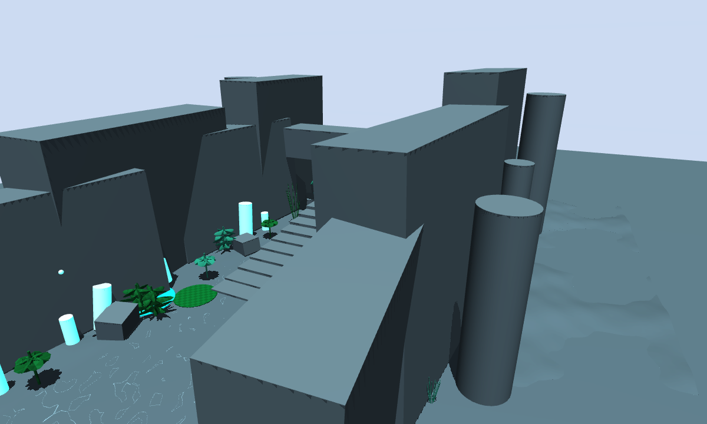
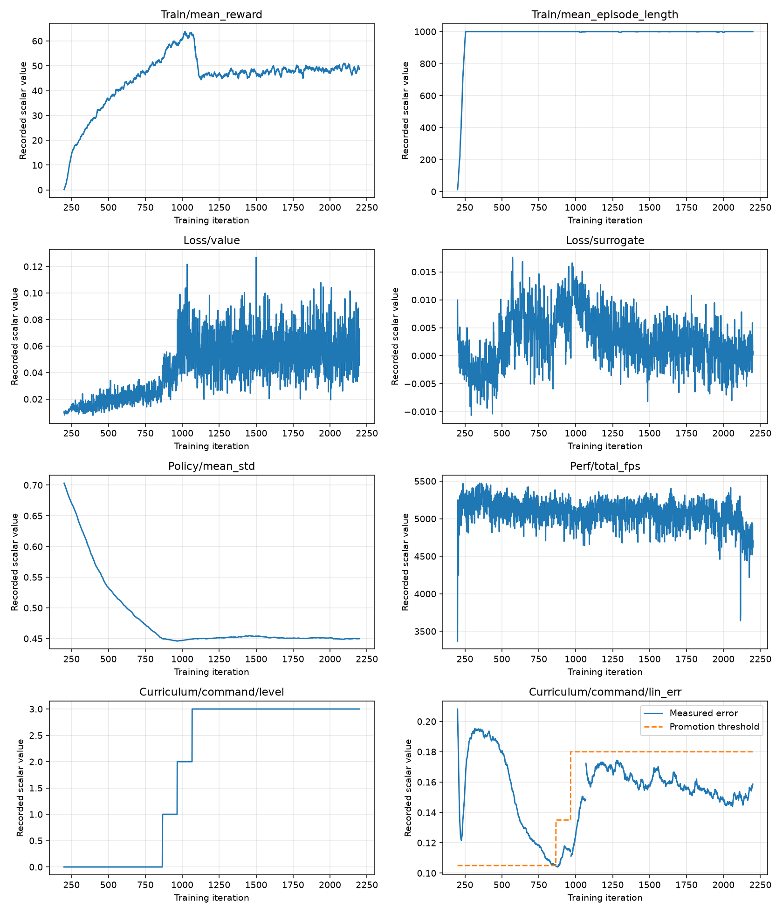
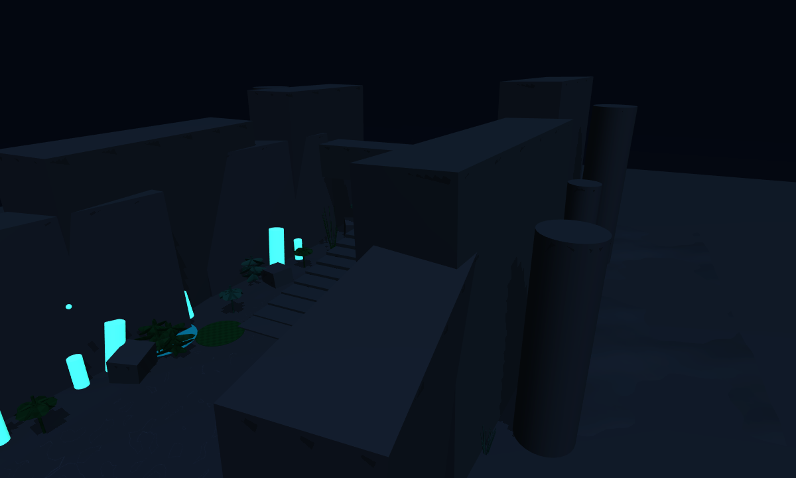
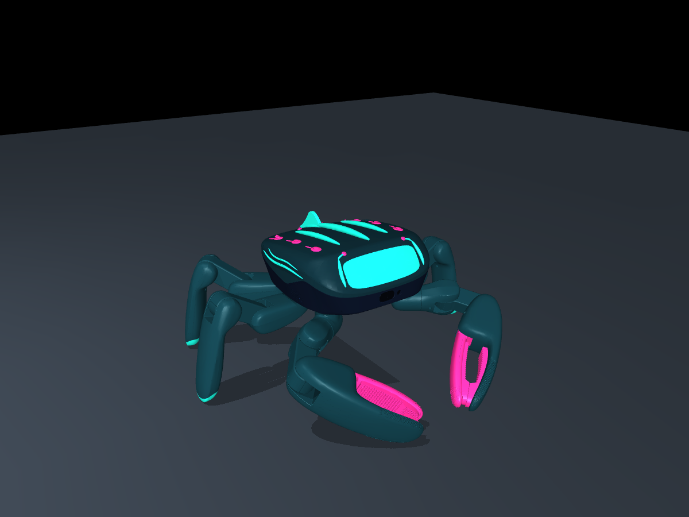

# Project Lumen Reef - Autonomous Temple Stair Climbing (Jumper Challenge)

A reinforcement-learning entry for the **Jumper** hexapod challenge: a proprioceptive
tripod-gait policy that learns to climb the ten-step **Lumen Temple** staircase, wrapped
in the bioluminescent **Lumen Reef** shell.

The policy was trained for **2,200 iterations** with PPO and reached **Curriculum
Level 3**. The final policy clears the staircase using only proprioception - no terrain
scanner, no height map, no external state estimator - so the same exported network can
run in the official simulator and on the deployment controller.



## Results

| Metric | Value |
|---|---|
| Training iterations | 2,200 |
| Final checkpoint | `model_2200.pt` (identical alias of the trainer's last file, `model_2199.pt`) |
| Curriculum | **Level 3** reached at ~iteration 1,000 and held to the end |
| Mean reward | ~50 at convergence |
| Mean episode length | 1,000 steps (no early termination) |
| Policy action std | converged from 0.70 to ~0.45 |
| Control rate | 50 Hz |
| Observation / action | 411 / 20 |
| Gait | Tripod |
| Staircase | 10 steps, 0.03-0.06 m rises, 0.30 m run, 1.8 m wide, 0.44 m top |



The curriculum panel is the important one: the command curriculum steps through Levels
1, 2 and 3 at roughly iterations 850, 950 and 1,000, once the measured linear-velocity
error drops below the promotion threshold. The policy then keeps training at the full
command range for the remaining ~1,200 iterations.

## Training replay clips

Two 15-second replays of the exported checkpoints, captured in the training environment
(`temple_stairs`, 200 Hz, 640x480, 30 fps, red robot). For display the reset is pinned to
the default start pose - at the base of the staircase, yaw 0 - because training normally
randomises the robot's x/y offset and yaw. The command is 0.5 m/s forward.

| Checkpoint | Replay |
|---|---|
| `model_1000.pt` | [`media/model_1000_training.mp4`](media/model_1000_training.mp4) |
| `model_2199.pt` / `model_2200.pt` | [`media/model_2200_training.mp4`](media/model_2200_training.mp4) |

These are training replays, not the web-simulator capture.

## The task

The staircase is a physical prop built by the task itself, not a height field, so the
policy cannot accidentally train on flat ground when a scene flag is missing.

- **Geometry** (`scenes/temple_stairs.py`): rises of
  `0.03, 0.03, 0.04, 0.04, 0.04, 0.04, 0.05, 0.05, 0.06, 0.06` m, a 0.30 m run,
  1.8 m width and a 0.44 m top.
- **Gait**: the tripod skeleton supplies the gait, velocity tracking and command
  curriculum. The stairs task changes only what climbing needs.
- **Foot lift**: the swing target is raised from 0.025 m to **0.06 m**, matching the
  tallest rise.
- **Reward shaping**:
  - `climb_height` **+1.5** - normalised root-height progress from 0.10 m to 0.39 m.
  - `backward_lean` **-2.0** - backward base velocity plus squared tilt beyond 0.35.
  - `foot_clearance` **-3.0** and `foot_swing_height` **-0.5** - stronger penalties
    around the raised target, so feet clear the vertical edge instead of catching it.
  - The tripod velocity, upright and regularization terms are inherited unchanged.
- **Observations**: base angular velocity, projected gravity, joint positions,
  joint velocities, previous actions, velocity commands, joint torques and gait phase.
  The actor never observes the staircase; it finds it by contact.

## Repository layout

```
lumen-reef-challenge/
|-- README.md
|-- LICENSE                     Apache-2.0
|-- NOTICE                      upstream attribution
|-- apps/
|   |-- stairs_1000.app         simulator bundle for the iteration-1000 checkpoint
|   `-- stairs_final.app        simulator bundle for the final checkpoint (2199)
|-- checkpoints/
|   |-- model_1000.pt           mid-training checkpoint, already at Curriculum Level 3
|   |-- model_2199.pt           the trainer's final saved file
|   |-- model_2200.pt           requested alias, byte-identical to model_2199.pt
|   `-- README.md               which checkpoint maps to which app
|-- docs/
|   |-- training_curve.png      reward, curriculum, loss and policy statistics
|   `-- ...
|-- design/
|   |-- lumen-temple.map        built Lumen Temple map (skin included)
|   |-- lumen-reef.skin         bioluminescent Lumen Reef shell
|   |-- lumen-temple.scene.json source scene
|   |-- lumen-temple-light.png  light look used in the capture
|   |-- lumen-temple-night.png  authored night look
|   |-- lumen-reef-skin.png     shell preview
|   `-- design-brief.md         design intent and palette
|-- media/
|   |-- model_1000_training.mp4 training replay for model_1000
|   |-- model_2200_training.mp4 training replay for the final checkpoint
|   `-- README.md               replay setup and checkpoint pairing
|-- training/
|   |-- tasks/jumper/stairs/    the registered jumper.stairs task
|   |-- tasks/jumper/tripod/    modified tripod env_cfg.py (foot_target_height)
|   |-- scenes/temple_stairs.py staircase geometry and training look
|   |-- tests/test_task_parity.py
|   |-- notebooks/jumper_colab.ipynb
|   |-- tools/colab.py
|   `-- COLAB_STAIRS.md         exact Colab and export commands
```

The training directory mirrors the upstream [`KingKongRobotics/jumper`](https://github.com/KingKongRobotics/jumper)
tree. It is an **overlay**, not a standalone copy of the framework: copy it over a fresh
checkout of that repository to reproduce the run.

## Use the trained policy in the official simulator

The official Jumper web simulator loads a policy bundle (`.app`). Pick one:

- **Final policy**: [`apps/stairs_final.app`](apps/stairs_final.app) - trained for 2,200
  iterations, Curriculum Level 3.
- **Earlier snapshot**: [`apps/stairs_1000.app`](apps/stairs_1000.app) - iteration 1,000,
  the point where Level 3 was first reached.

Open the official simulator, choose the bundle-upload / `.app` entry point, and load the
file. The bundle already contains:

- the exported ONNX policy (`models/stairs.onnx`),
- the deployment contract (`stairs.json`: joint order, gains, observation layout,
  command ranges),
- the deployment controller for the browser (`runtime/web/controller.wasm` and `.js`),
- the controller FSM (`controller.toml`) with `jumper.stairs` as its default task,
- a recorded reference run (`reference.json`) that the controller replays on load.

The bundles are **simulator builds**. They contain ONNX and the web/native controller,
but no `.rknn` and no board runtime, so they are not intended for the physical robot.

### Local simulator

If you run the upstream repository locally:

```bash
# from a checkout of KingKongRobotics/jumper
python scripts/play.py --app /path/to/lumen-reef-challenge/apps/stairs_final.app
```

`play --app` selects `jumper.stairs` from the bundle, builds the temple world, and drives
the simulated servos with the controller's own joint targets. The operator bindings come
from the bundle: the left stick walks and strafes, the right stick turns, and the
keyboard uses `W/A/S/D` or the arrow keys, `J/L` to turn, and `Esc` to release. A gamepad
is supported through the same contract.

The app's embedded reference pass was verified on the build host: replaying the 24
recorded frames gives **0.000e+00** observation and target error.

## Reproduce the training run

1. Clone the upstream training repository and install its environment by following its
   setup guide.
2. Copy this repository's training overlay over the checkout:

   ```bash
   # from the root of a fresh KingKongRobotics/jumper checkout
   cp -r /path/to/lumen-reef-challenge/training/tasks/jumper/stairs tasks/jumper/stairs
   cp /path/to/lumen-reef-challenge/training/tasks/jumper/tripod/env_cfg.py tasks/jumper/tripod/env_cfg.py
   cp /path/to/lumen-reef-challenge/training/scenes/temple_stairs.py scenes/temple_stairs.py
   cp /path/to/lumen-reef-challenge/training/scenes/__init__.py scenes/__init__.py
   cp /path/to/lumen-reef-challenge/training/tasks/__init__.py tasks/__init__.py
   cp /path/to/lumen-reef-challenge/training/tests/test_task_parity.py tests/test_task_parity.py
   cp /path/to/lumen-reef-challenge/training/tools/colab.py tools/colab.py
   cp /path/to/lumen-reef-challenge/training/notebooks/jumper_colab.ipynb notebooks/jumper_colab.ipynb
   ```

3. Train on the staircase:

   ```bash
   python tools/colab.py train \
     --repo . --task jumper.stairs --model jumper \
     --num-envs 256 --iterations 2200 \
     --manifest session/stairs.json --scene temple_stairs
   ```

   The equivalent interactive notebook path is documented in
   [`training/COLAB_STAIRS.md`](training/COLAB_STAIRS.md). Select **TASK =
   jumper.stairs**, **NUM_ENVS = 256**, and start with **ITERATIONS = 2200**.

4. Replay the policy:

   ```bash
   python scripts/play.py \
     --task jumper.stairs --model jumper \
     --checkpoint checkpoints/model_2199.pt \
     --scene temple_stairs --backend warp --device cuda:0 \
     --num_envs 1 --headless --steps 1250 \
     --video stairs.mp4
   ```

5. Export a new bundle after training:

   ```bash
   python scripts/export.py \
     --task jumper.stairs --model jumper \
     --checkpoint <run>/model_<N>.pt \
     --out tasks/jumper/stairs/out/<run>

   python scripts/deploy.py \
     --mode stairs=tasks/jumper/stairs/out/<run> \
     --bundle out/app-stairs --allow-incomplete
   ```

   `--allow-incomplete` is the browser/simulator build: it skips the Docker cross-builds
   and RKNN conversion. A full board build needs Docker, Rust and the RK conversion
   toolchain.

## Design assets

The **Lumen Reef** shell and **Lumen Temple** map are included in [`design/`](design/).
The map already embeds the skin; the standalone `.skin` is included for editing or for
loading the shell on another map.

- **Lumen Reef** - low bioluminescent carapace, pearl/ivory shell, deep teal and indigo
  limbs, cyan joint accents, magenta claw tips.
- **Lumen Temple** - ten-step basalt staircase, altar platform at 0.44 m, floating gold
  treasure, aqua fog and cyan bioluminescence.

The map is authored with a **night** look. The final capture used the **light** look of
the same map - cyan walls and floor - which is how the web simulator presents it. Both
previews are included:

| Light look - used in the capture | Authored night look |
|---|---|
|  |  |



The design workflow lives in the upstream
[`KingKongRobotics/jumper-design`](https://github.com/KingKongRobotics/jumper-design)
repository. Copy `design/lumen-temple.map` and `design/lumen-reef.skin` into that
workflow's content library, or load the map directly in the official simulator.

## Checkpoints and artifacts

| Artifact | Built from | Notes |
|---|---|---|
| `apps/stairs_1000.app` | `checkpoints/model_1000.pt` | Iteration 1,000; Curriculum Level 3 just reached |
| `apps/stairs_final.app` | `checkpoints/model_2199.pt` / `model_2200.pt` | Final checkpoint of the 2,200-iteration run |
| `checkpoints/model_1000.pt` | - | 2,200-iteration run, iteration 1,000 |
| `checkpoints/model_2199.pt` | - | 2,200-iteration run, final saved iteration |
| `checkpoints/model_2200.pt` | - | Byte-identical alias of `model_2199.pt` |

Checkpoint numbering is zero-indexed. The run is described as **2,200 iterations**, so
the last file written by the trainer is `model_2199.pt`. For convenience, the requested
`model_2200.pt` is included as a byte-identical copy; its SHA-256 equals the SHA-256 of
`model_2199.pt` (`F7BB73585FED82E433A2823B26D79571156F6B5B8C75092FAF39AC886558BA7A`).

## License and attribution

This project is built on the Jumper ecosystem by **KingKong Robotics**:

- [`KingKongRobotics/jumper`](https://github.com/KingKongRobotics/jumper) - training,
  deployment and simulator framework (Apache-2.0).
- [`KingKongRobotics/jumper-design`](https://github.com/KingKongRobotics/jumper-design) -
  robot design, skin and map tooling (Apache-2.0).

The task code, scene, checkpoint policies, exported bundles and design assets in this
repository are derivative work for the Lumen Reef challenge. See [`LICENSE`](LICENSE)
and [`NOTICE`](NOTICE) for the full license and provenance statement. Third-party
components imported by the upstream projects keep their own licenses; none of the
upstream framework code is vendored here.
